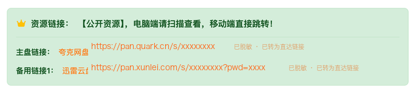

# WPFX 网盘链接直达

一个零依赖的 Tampermonkey 用户脚本，将 WPFX 资源详情页中的网盘按钮转换为可直接打开的真实链接。

## 功能

- 将页面已有的网盘地址显示为完整链接，并在新标签页打开。
- 自动处理页面加载后动态插入的网盘按钮。
- 移除已出现的二维码弹层，减少重复操作。
- 仅转换合法的 HTTP/HTTPS 绝对地址，拒绝 `javascript:`、`ftp:`、相对地址和无效内容。
- 不使用 `@require`、`@connect` 或任何第三方依赖。

## 效果截图



## 安装

推荐直接打开 [Greasy Fork 安装页](https://greasyfork.org/zh-CN/scripts/594099-wpfx-%E7%BD%91%E7%9B%98%E9%93%BE%E6%8E%A5%E7%9B%B4%E8%BE%BE)，点击“安装此脚本”，后续版本可由 Tampermonkey 自动更新。

也可以通过 GitHub 安装：

1. 在浏览器中安装 Tampermonkey。
2. 打开 [GitHub Raw 安装地址](https://raw.githubusercontent.com/zyh364267040/wpfx-direct-link-userscript/main/WPFX%E7%BD%91%E7%9B%98%E9%93%BE%E6%8E%A5%E7%9B%B4%E8%BE%BE.user.js)。
3. 在 Tampermonkey 安装页确认安装，然后刷新目标页面。

## 使用

访问匹配的 WPFX 资源详情页后，脚本会自动把有效的网盘按钮转换为“网盘名：完整 URL”，并显示“已转为直达链接”标识。点击链接即可在新标签页打开，无需额外配置。

## 隐私与安全

脚本不收集、存储或上传数据，不发起后台网络请求，也不加载远程代码。它只读取当前页面网盘按钮已有的 `data-disk-url` 属性并修改本地页面 DOM。打开转换后的链接属于用户主动导航，目标站点的隐私政策仍由对应服务提供方负责。

## 开发与验证

项目仅使用 Node.js 内置模块，无需安装依赖，也不需要 `package.json` 或锁文件。建议使用 Node.js 22：

```sh
node --test
node scripts/build.js
node --check WPFX网盘链接直达.user.js
git diff --check
```

修改 `src/` 中的源码后，请运行构建命令并一并提交生成的 `WPFX网盘链接直达.user.js`。

## 兼容范围

- 用户脚本管理器：Tampermonkey。
- 页面范围：仅 `https://wpfx.org/ziyuan/*` 和 `https://wpfx.org.cn/ziyuan/*`，不匹配其他主机或子域名。
- 页面条件：网盘按钮为带有 `data-disk-url` 属性的 `a.disk-link` 元素。
- 地址协议：仅 HTTP 和 HTTPS。

脚本依赖目标页面当前的 DOM 结构；若网站改版，可能需要同步调整。

## 免责声明

本项目仅改善页面链接的访问方式，不提供、托管或验证任何第三方资源。请遵守目标网站、网盘服务及所在地适用的法律法规；使用本项目产生的风险由使用者自行承担。

## 许可证

[MIT](LICENSE)
